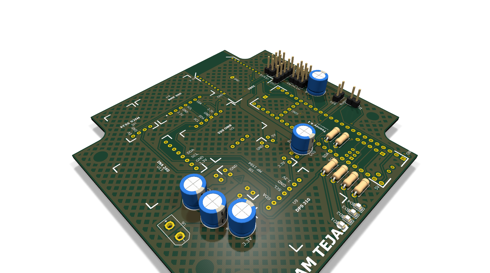
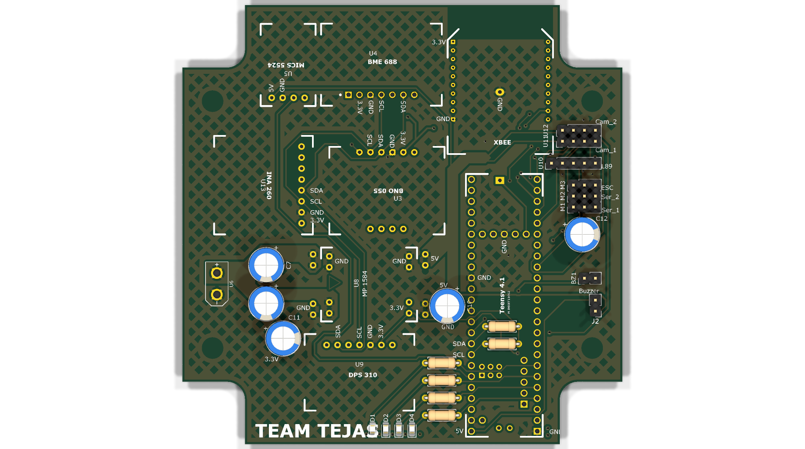
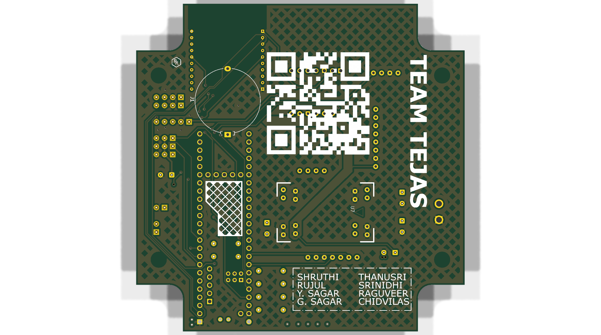

# Tejas CanSat — Onboard Computer (OBC) PCB

Carrier board for our INSPACe CanSat ("Tejas") — Teensy 4.1, XBee radio, and a full
sensor suite (BNO055, BME688, DPS310, INA260, MICS5524) with dual buck regulators,
servo/ESC headers, and buzzer on a ~102×102 mm 2-layer board.

Designed by me (**Rujul Rumale**) in KiCad, Oct 2025 — schematic, layout, and Gerber
release. I also put together the data-processing section of our PFR deck.

| Top | Bottom |
|---|---|
|  |  |

*Renders: KiCad raytracer. The custom module 3D bodies use absolute paths from my
old workstation, so modules show as footprints here — geometry and Gerbers are unaffected.*

## Board at a glance

- **Size:** 101.9 × 101.9 mm, 1.6 mm stackup, 2-layer (`docs/board-stats.rpt`)
- **Parts:** 41 BOM lines (`docs/bom.csv`) — Teensy 4.1, XBee, BNO055, BME280/BME688,
  MICS5524, DPS310, INA260, 2× buck (MINI560/MP1584), XT30, coin-cell retainer,
  servo/ESC headers
- **Copper:** 0.3 mm min track, 0.2 mm clearance, 38 vias, 199 pads
- **Fun detail:** the bottom silkscreen carries `TEAM TEJAS`, a QR code, and our
  team names — see `docs/renders/gerber-compare/v4-bottom.png`

## What's in here

| Path | What it is |
|---|---|
| `hardware/` | KiCad project — schematic (rev 2), layout, project settings. Opens in KiCad 9.0+ |
| `manufacturing/gerber-V4/` | The Gerber release we sent to fab (12 files, Oct 9) |
| `manufacturing/gerber-V3/` | Same design, plotted ~90 s earlier — kept for reference |
| `docs/renders/` | 3D PNGs, 2D front/back SVGs, schematic PDF, V3-vs-V4 Gerber comparisons |
| `docs/bom.csv` | Bill of materials, exported from the schematic |
| `docs/board-stats.rpt` | Layer / component / drill statistics |
| `docs/Tejas.pdf`, `docs/Tejas_Sch.pdf` | Board and schematic exports from the project |
| `libs/` | The symbol/footprint/3D libraries this board uses — see `libs/README.md` |
| `history/` | 25 KiCad auto-backup snapshots (Oct 4–18) plus the earliest Oct 3 schematic draft |
| `DESIGN_NOTES.md` | How the design evolved, and revision status |

## My work on this project

Team effort overall — I did the **full PCB** (schematic capture, footprint work,
layout/routing, DRC, Gerber release) and the **data-processing part of our PFR
presentation**. Flight software, GUI, MCP server, and telemetry ops were my
teammates' work.

## Revision status

`manufacturing/gerber-V4/` is the release we flew. The working board file in
`hardware/` has a later board-outline experiment (stepped/notched edge, mounting
holes removed) that we decided not to go with — details in `DESIGN_NOTES.md`.
So if you want to build this, use the V4 Gerbers.

## Reuse

Hardware is shared under the **CERN Open Hardware Licence v2 (Strongly
Reciprocal)** — see `LICENSE`. Docs/images are CC-BY-4.0.

SPDX: `SPDX-License-Identifier: CERN-OHL-S-2.0`
